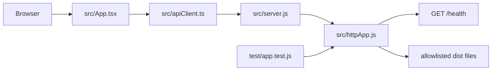

# Documentation

## 1. Document Metadata

- Project name: BackendGudang
- Document version: 0.1.0
- Last updated: 2026-10-24
- Last verified: 2026-10-24 (Node 26.12.1 build/tests/audit and browser request checks on Windows; Linux/remote CI pending)
- Current branch or revision: `main`; repository status was clean before this documentation task
- Status: partially verified

## 2. Project Overview

The project provides a small HTTP backend and a same-origin API testing playground. Provisional warehouse assessment and survey-planning documents are now available under `docs/warehouse/`; no physical site facts, inventory workflows, warehouse domain API, database schema, or stock operations have been verified or implemented. Warehouse workflows, user roles, and data rules remain unknown and intentionally are not invented.

## 3. Technology Stack

| Technology | State |
| --- | --- |
| Node.js 26.12.1 | Requested target; official release page lists v26 as Current as of 2026-10-24, not LTS |
| Node.js 24.21.0 | Default local runtime; does not satisfy the package engine constraint |
| Node.js 26.12.1 | Installed through fnm and used to run the baseline tests and dependency audit on Windows |
| npm | Installed version 12.1.0; lockfile v3 |
| HTTP framework | None; uses `node:http` |
| Frontend | React, TypeScript, Vite, Lucide React |
| Styling | Local CSS design tokens and responsive styles; DM Sans, DM Mono, and Manrope bundled locally |
| Database, authentication, logging package | Not selected |
| Testing | Built-in `node:test`, Vitest, Testing Library, jsdom, vitest-axe |
| CI | GitHub Actions configured for Ubuntu and Windows; remote result not yet available |

The official Node.js release policy recommends Active or Maintenance LTS for production. Node 26 entered Current on 2026-10-21. Keep the requested target, but obtain approval before changing it; reassess deployment readiness when it transitions to LTS. Verified against https://nodejs.org/en/about/previous-releases on 2026-10-24.

## 4. Architecture

The backend is a single-process Node HTTP service. `src/server.js` validates the listening port, starts the server, and handles termination signals. `src/httpApp.js` serves the health API and an explicitly allowlisted Vite build from `dist`. The React UI uses `src/apiClient.ts` for same-origin HTTP and keeps presentation in `src/App.tsx`.



## 5. Project Structure

- `src/server.js`: runtime entry point and listening configuration.
- `src/httpApp.js`: API behavior and production static file serving.
- `src/App.tsx`, `src/apiClient.ts`, `src/styles.css`: UI, centralized request execution, and design system.
- `test/app.test.js`, `src/*.test.*`: backend, frontend, and request-client tests.
- `index.html`, `vite.config.ts`, `tsconfig.json`: frontend entry and tool configuration.
- `docs/warehouse/`: provisional assessment, survey template, conceptual flow, location coding proposal, pilot SOP, implementation plan, KPI measurement plan, and safety prompts. These are not approved operating instructions or a measured site plan.
- `skills/`: project-specific workflow instructions; automatic discovery is tool-dependent.
- `docs/architecture/PROJECT_MAP.md`: concise component and dependency map.
- `.github/workflows/ci.yml`: Windows/Linux CI definition.

## 6. Module Registry

| Module | Purpose and contract | Dependencies/data | Tests/status |
| --- | --- | --- | --- |
| HTTP baseline | `GET /health` returns `200` and `{"status":"ok"}`; other paths return `404`; non-GET requests return `405` with `Allow: GET` | Node built-ins only; no stored data | `test/app.test.js`; implemented |
| API Playground | Overview, source-verified explorer/docs, same-origin request builder, transient bearer header, measured response viewer, memory-only history, health assertion suite | Same-origin browser fetch; browser token remains in React state only | `src/App.test.tsx`, `src/apiClient.test.ts`; implemented, visual browser review pending |
| Warehouse planning documentation | Evidence-based initial assessment and field survey templates; provisional coding/layout/process proposals; implementation, KPI and safety planning | Repository inspection only; no warehouse/site inputs; no inventory data | `docs/warehouse/*.md`; planning only, no site survey or operational implementation |
| Warehouse domain | Not defined | Unknown | Not implemented; requires user requirements |

## 7. API Reference

| Method | Path | Auth | Response | Errors |
| --- | --- | --- | --- | --- |
| GET | `/health` | None; liveness only | `200 application/json`, `{"status":"ok"}`, `Cache-Control: no-store` | `404` for unknown paths |

Non-GET requests currently receive `405` with `Allow: GET`. This endpoint does not check database or downstream readiness and must not be treated as a readiness probe.

## 8. Database Reference

No database, schema, migrations, transaction boundaries, backup, or retention policy exists. Do not add or modify production data without explicit authorization and a recovery plan.

## 9. Configuration and Environment

| Variable | Required | Default | Validation/use |
| --- | --- | --- | --- |
| `HOST` | No | `127.0.0.1` | Interface passed to `server.listen`; use an explicit deployment value when external access is required |
| `PORT` | No | `3000` | Integer from 1 through 65535; invalid values stop startup |

No `.env` loader is installed. Do not commit actual secret values. The baseline currently has no secrets.

## 10. Security Model

- The only route exposes process liveness and no business or personal data.
- The listener defaults to loopback; production network exposure, TLS termination, and proxy configuration are not defined.
- JSON responses set `Cache-Control: no-store` and `X-Content-Type-Options: nosniff`.
- There is no authentication, authorization, CORS policy, rate limiting, request-body parsing, database access, or audit logging because the requirements and threat model are not known.
- Node 26 is Current rather than LTS on the verification date; production deployment risk remains open.

## 11. Installation and Development

Prerequisite: Node.js 26.12.1 and npm. Node 26 is pinned in `.nvmrc` and declared in `package.json`; install it using an approved version manager. The default machine runtime is Node 24.21.0, but Node 26.12.1 is available through fnm and was used for verification.

Windows PowerShell and Linux shell:

```sh
npm ci
npm test
npm start
```

The backend listens on `127.0.0.1:3000`; configure `HOST` and `PORT` using the environment syntax for your shell. For development, run `npm run dev` and keep the backend on port 3000; Vite proxies API paths to that fixed local backend while excluding Vite modules and assets. For production-style local use, run `npm run build` then `npm start` to serve `dist` and the API on the same origin. The Vite development server is for trusted local use; do not expose it to an untrusted network. Cross-platform CI is configured but has not yet run remotely.

## 12. Scripts and Commands

- `npm start`: starts `src/server.js`.
- `npm run dev`: starts the Vite development server (backend must run on `127.0.0.1:3000`).
- `npm run build`: runs TypeScript checking and builds the frontend into `dist/`.
- `npm test`: runs backend Node tests and Vitest UI/API client tests.
- `npm run test:ui`: runs only frontend tests.
- `npm ci`: installs the pinned runtime and development dependency set from `package-lock.json`.

## 13. Testing and Quality Gates

Backend tests cover health, unknown route, method rejection, and built static asset headers. Frontend tests cover same-origin restrictions, parsing, credential/query redaction guardrails, timeout/network normalization, cancellation, response-size cap, actual response rendering, and axe DOM rules (color contrast is excluded because jsdom does not render layout/canvas). `npm ci`, `npm test`, `npm run build`, and `npm audit --audit-level=high` passed on Windows with Node 26.12.1 on 2026-10-24. The GitHub Actions matrix configures Node 26.12.1 on Windows and Ubuntu, but no remote workflow result has been observed. Browser checks verified health 200, unknown-route 404, dark mode, and mobile width without horizontal overflow. Visual contrast, broad browser compatibility, Linux, and remote CI remain unverified.

## 14. CI/CD

`.github/workflows/ci.yml` runs on push and pull request, grants read-only repository contents permission, installs with `npm ci`, runs tests, builds the UI, and runs `npm audit --audit-level=high` on Ubuntu and Windows. There is no deployment workflow, production secret, or rollback procedure. Build output is local under `dist/` and ignored by Git.

## 15. Deployment and Operations

No deployment target, reverse proxy, TLS setup, monitoring, backup, or production runbook has been selected. The server handles `SIGINT` and `SIGTERM` by closing its HTTP listener. Static responses set a self-only CSP (`connect-src 'self'`, `font-src 'self'`), frame denial, and nosniff. Fonts are emitted as local files under `dist/assets`. Do not expose the service publicly until binding, TLS, network policy, health/readiness behavior, and operational requirements are decided.

## 16. Dependency Registry

Runtime packages: React, React DOM, Lucide React, and local Fontsource font families. Development packages: Vite, React Vite plugin, TypeScript, Vitest, jsdom, Testing Library, vitest-axe, and React type definitions. Exact versions are pinned by `package-lock.json`; `npm audit` is configured in CI.

## 17. Project Skills and Agent Instructions

- `AGENTS.md`: repository-wide agent requirements.
- `skills/project-analysis/SKILL.md`: initial evidence gathering and scoping.
- `skills/backend-development/SKILL.md`: focused backend implementation.
- `skills/testing-security/SKILL.md`: behavior and security verification.
- `skills/documentation-maintenance/SKILL.md`: documentation synchronization.
- `skills/frontend-development/SKILL.md`: frontend implementation.
- `skills/api-testing/SKILL.md`: API request and assertion workflows.
- `skills/ui-ux-accessibility/SKILL.md`: interaction and accessibility requirements.
- `skills/frontend-security/SKILL.md`: browser credential and destination restrictions.
- `docs/warehouse/WAREHOUSE_ASSESSMENT.md`: verified project evidence, unknown site facts, survey priorities and risk register.
- `docs/warehouse/FIELD_SURVEY_TEMPLATE.md`: fillable measurement, flow, inventory sample, interview, and sign-off forms.
- `docs/warehouse/WAREHOUSE_LAYOUT.md`: non-scaled process concept and post-survey map gates.
- `docs/warehouse/LOCATION_CODING_STANDARD.md`: provisional code patterns and empty location register template.
- `docs/warehouse/location_register_template.csv`: header-only CSV for verified survey results; no sample locations are populated.
- `docs/warehouse/WAREHOUSE_PILOT_SOP.md`: draft receiving, putaway, transfer, issue, count, exception and handover controls; not authorized for use.
- `docs/warehouse/IMPLEMENTATION_PLAN.md`: staged survey/pilot/digitalization, cost worksheet, migration, and stop/rollback gates.
- `docs/warehouse/KPI_BASELINE.md`: KPI definitions and measurement plan; all baselines remain unmeasured.
- `docs/warehouse/SAFETY_RISK_REGISTER.md`: initial hazard screening prompts; not a site risk assessment.

Tools do not necessarily discover the `skills/` directory automatically; `AGENTS.md` links the workflow expectation without claiming platform-specific auto-loading.

## 18. Architecture Decision Records

- Baseline uses Node built-in HTTP and testing modules to avoid choosing an unrequested framework or adding supply-chain dependencies. Revisit when confirmed business and operational requirements warrant it.
- Runtime target remains Node 26 as explicitly requested. It is currently Current, not LTS; changing the target requires user approval.
- Listener defaults to `127.0.0.1` to avoid accidental network exposure during development.
- Frontend requests are restricted to the current origin; no arbitrary host proxy or configurable staging/production target is present.
- Bearer token input is supported transiently in component memory; no backend route currently requires or validates it. Basic, API-key, cookie/session, and OAuth flows are not implemented.
- History is in-memory for the current tab and stores method, path without query, status, duration, and timestamp only; it excludes headers, token, and body. Refresh clears it. Export is not currently implemented.
- The only implemented test suite is a real read-only health assertion. CRUD suites, manual saved requests, multipart/form-urlencoded editors, and custom environments are not implemented. Request cancellation is available while a request is in flight; response reading is capped at 1 MiB and visibly marked if truncated.

## 19. Known Issues and Technical Debt

- Business scope, warehouse entities, workflows, roles, and API contracts are undefined.
- Warehouse planning artifacts are provisional and based only on repository evidence; no warehouse drawing/photo/inventory/process file was present in the inspected workspace. No physical survey, capacity estimate, location assignment, cost quote, or implementation has occurred.
- The development UI proxies API paths to the fixed backend at `127.0.0.1:3000`; the proxy is a development convenience, not an environment allowlist or production service.
- Browser bearer field is a generic testing control, not evidence of backend authentication support; credentials remain accessible to scripts on the UI origin until cleared or the page is closed.
- No custom/staging/production environments, OAuth, API key/basic/cookie auth, saved suites, history export, or persisted history are available.
- Accessibility test runs axe DOM rules but does not establish WCAG 2.2 AA visual contrast or real-browser keyboard/mobile behavior.
- Node 26 is not LTS on the verification date; production readiness requires a decision about support risk.
- The default shell runtime is Node 24, but target Node 26.12.1 is available through fnm and was used for verification.
- Windows/Linux CI is configured, not yet remotely verified.
- No database, authentication, authorization, TLS/deployment configuration, structured request logging, rate limiting, or readiness check exists.
- Git branch is `main`; no commit/revision is included in this document update.

## 20. Change Log

| Date | Change | Verification |
| --- | --- | --- |
| 2026-10-24 | Added minimal Node HTTP baseline, health route, tests, CI matrix, agent guidance, skills, and project map | `npm test` and `npm audit --audit-level=high` on Windows with Node 26.12.1; remote CI and Linux remain unverified |
| 2026-10-24 | Added same-origin React API playground, bounded static serving, frontend tests, local fonts, and build CI gate | `npm ci`, `npm test`, `npm run build`, and `npm audit --audit-level=high` on Windows with Node 26.12.1; browser verified health 200, manual unknown-route 404, dark mode, and mobile width without horizontal overflow; Linux and remote CI remain unverified |
| 2026-10-24 | Added provisional warehouse assessment, field survey and planning documents; no backend/domain implementation | Repository/document inspection only; no site survey or physical changes performed |