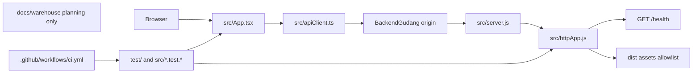

# Project Map

Status: partially verified implementation, 2026-10-24. Backend and frontend tests/build were run on Windows with Node 26.12.1. Linux CI remains configured but unverified.

## Entry points and flow

| Area | Files | Responsibility | Current state |
| --- | --- | --- | --- |
| Runtime entry | `src/server.js` | Read host/port, listen, log lifecycle, close on signals | Implemented; target Node 26 |
| HTTP application | `src/httpApp.js` | Health route plus narrowly allowlisted built frontend files | Implemented; no warehouse routes |
| Frontend | `src/App.tsx`, `src/apiClient.ts`, `src/styles.css` | Dashboard, same-origin requests, response inspection, in-memory session summary | Implemented; see limitations in `Documentation.md` |
| Build | `index.html`, `vite.config.ts`, `tsconfig.json` | Vite/TypeScript development and static build | Implemented |
| Tests | `test/app.test.js`, `src/*.test.*` | Backend contract, request client, UI, and axe DOM checks | Implemented |
| CI | `.github/workflows/ci.yml` | Install, test, build, and audit on Windows and Linux | Configured; remote result not observed |
| Project guidance | `AGENTS.md`, `skills/` | Agent workflow and review checks | Implemented; discoverability depends on agent tooling |
| Main documentation | `Documentation.md` | Verified state, setup, risks, and decisions | Partially verified |
| Warehouse planning docs | `docs/warehouse/*.md` | Provisional evidence assessment, survey templates, conceptual flow, draft SOP, pilot/migration/KPI/safety plan | Documentation only; no site data, approved layout, warehouse code, or operational authority |
| Survey data template | `docs/warehouse/location_register_template.csv` | Header-only location register for future verified survey data | No location rows populated |

## Dependencies and data flow

- Runtime dependencies: React, React DOM, Lucide icons, and locally bundled font packages.
- Build/test dependencies: Vite, TypeScript, Vitest, jsdom, Testing Library, and vitest-axe.
- UI uses same-origin `fetch`; backend serves production files from `dist` using an explicit path allowlist and restrictive CSP.
- No database, external service, background job, backend auth policy, or authorization rules exist. Browser bearer value is transient and never persisted.
- No warehouse API, inventory/location schema, warehouse UI, field survey data, measured layout, stock import, or physical change exists. Planning docs distinguish unknowns and require owner/safety approval before operational use.
- Configuration comes from `HOST` and `PORT`; the backend binds to loopback by default.