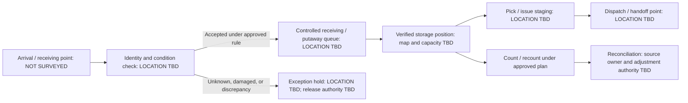

# Conceptual Warehouse Flow and Layout

**Status: PROVISIONAL — PERLU VERIFIKASI LAPANGAN**  
**Scale:** None. This is a process diagram, not a floorplan. No building boundary, dimensions, position, capacity, or site-specific zone has been verified.

## 1. Current State Map

No physical site map can be produced from current evidence. The repository contains no site drawing or photographs. Do not use the following process concept to direct stock placement or movement.

## 2. Process Concept for Workshop Only

The sequence below is a discussion aid. Each activity may already exist; its actual location, controls, and routing must be observed with operators and safety owners.

This does not assert that quarantine, staging, or dedicated receiving/shipping space currently exists. Do not create such an area until available space, safety, and operating authority are verified.

## 3. Layout Options to Evaluate After Survey

| Option | Potential benefit | Preconditions / risks | Decision gate |
| --- | --- | --- | --- |
| Label current physical positions before moving goods | Improves findability with low disruption | Must map each label to one position; exits and rating plates remain unobstructed | Surveyed register, operator validation, safety review |
| Reserve a clearly identified short-term receiving/inspection holding position | Prevents unverified goods being treated as available | Requires suitable space and an owner; avoid emergency routes and mixed/unsafe materials | Site walkthrough and supervisor/K3 approval |
| Separate exception/damaged/unknown goods from available stock | Reduces accidental issue | Only if safe, compatible, physically feasible, and an authorized release process exists | Safety/quality owner approval and pilot procedure |
| Slot frequent movers closer to safe pick/dispatch route | May reduce travel | Requires reliable movement history, dimensions/weight/compatibility, and congestion observation | Data sufficiency review and controlled pilot |
| Separate pedestrian/equipment flow or one-way routing | May reduce conflict | Depends on actual doors, equipment, aisle widths, code requirements, and egress | Qualified safety review; never infer dimensions |

No option is selected as the target layout. Aisle width, rack height, stack height, floor/rack load, and emergency clearance are intentionally not specified.

## 4. Site Map Production Checklist

When survey evidence exists, prepare a revision-controlled map with:

- Measured outline, dimensions, units, orientation, scale/method and uncertainty.
- Doors, emergency exits/routes, fire protection, electrical panels, columns, fixed plant, ramps, and other no-storage/clearance constraints verified with the responsible owner.
- Storage asset IDs, rack/row/floor positions, labels, faces, access method, and documented capacity basis.
- Inbound, inspection, exception/hold, storage, pick/issue, and dispatch points only where observed and approved.
- Pedestrian routes, equipment routes, crossings, and known queue/congestion points.
- Legend distinguishing `VERIFIED`, `USER-PROVIDED`, `ESTIMATE`, `UNKNOWN`, and `CONFLICT`.
- A visible `NOT TO SCALE` notice when dimensions do not support a scale drawing.
- Independent map-to-location-register check and owner approvals.

Use `FIELD_SURVEY_TEMPLATE.md` and `LOCATION_CODING_STANDARD.md`; never transform the conceptual diagram into a measured map without evidence.
